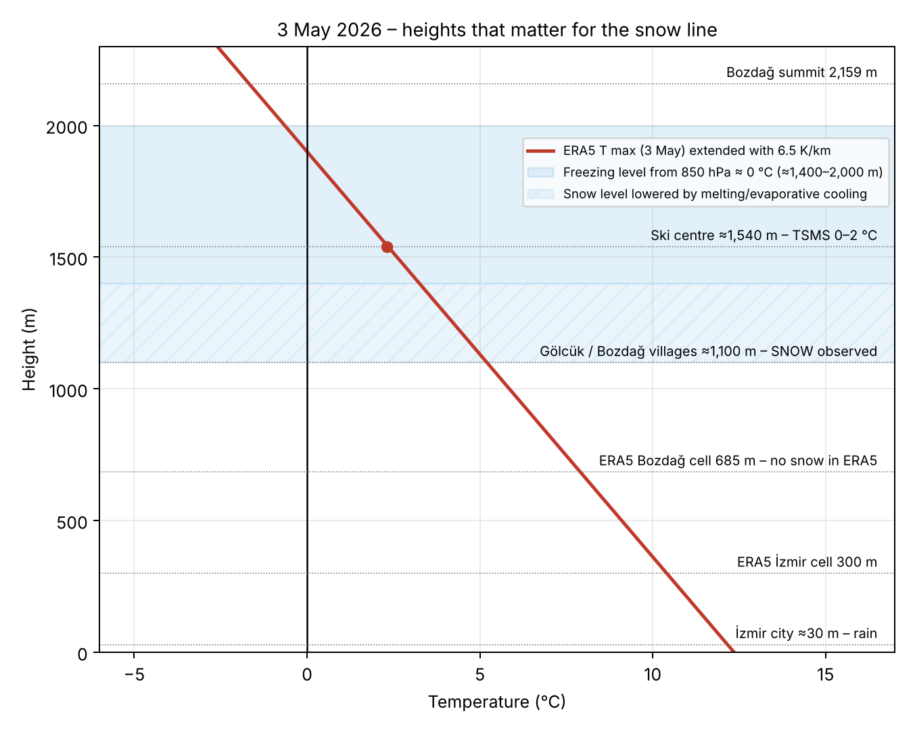
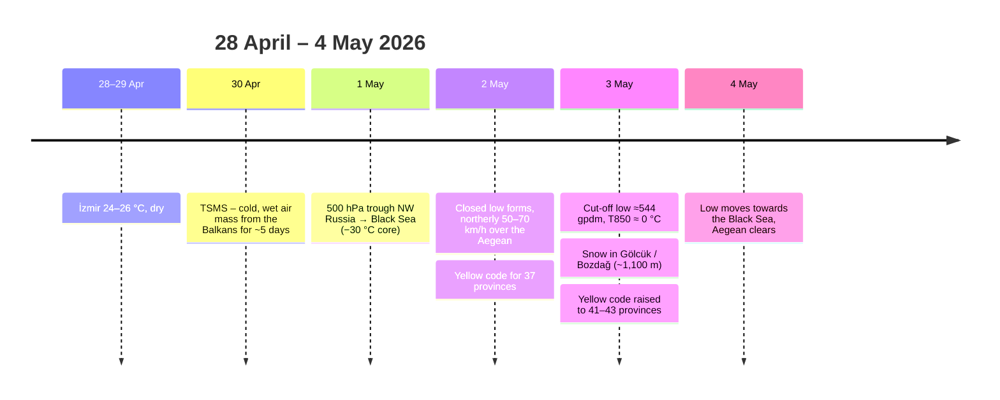
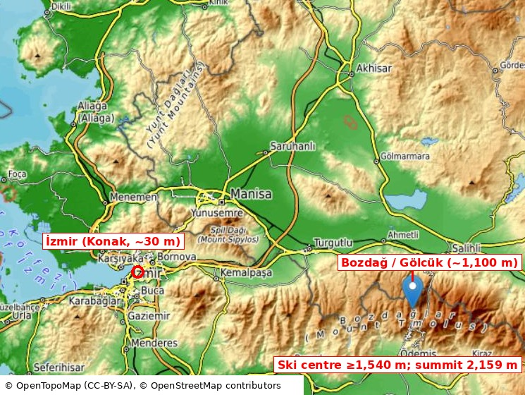
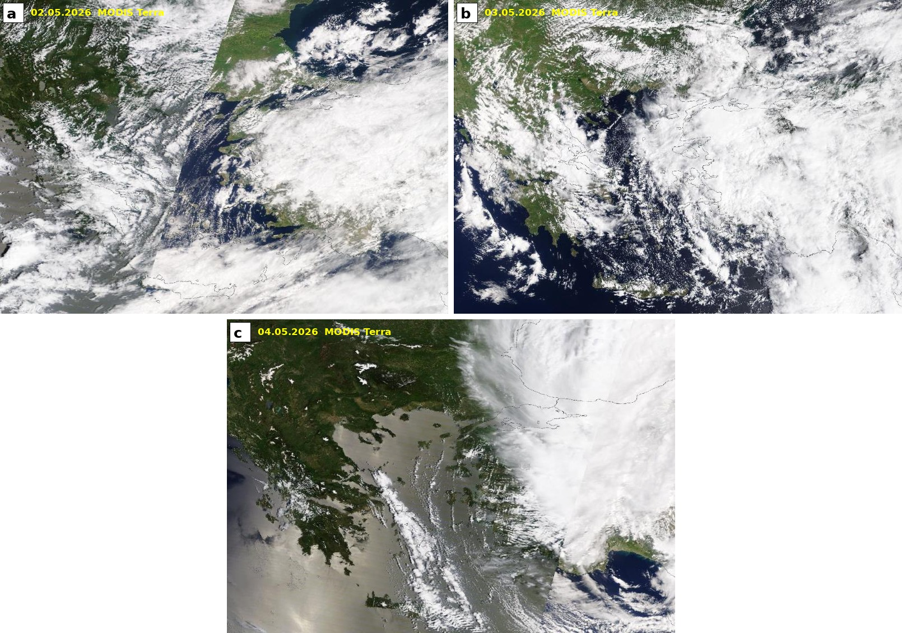
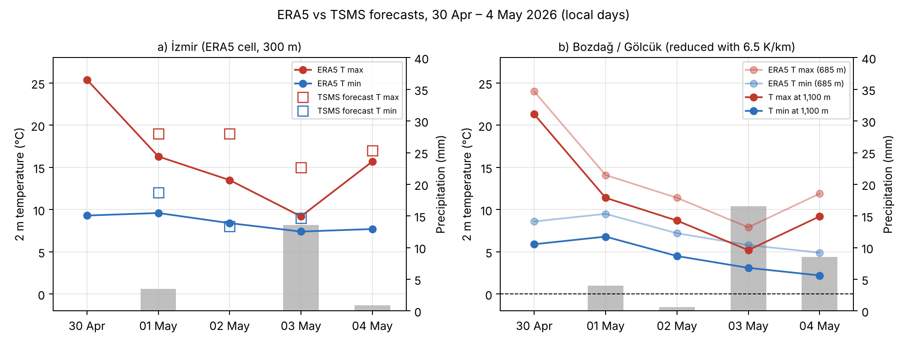

# ❄️ May Snow in İzmir – Bozdağ, 3 May 2026

A synoptic case study of an unusual spring snowfall at **≈1,100 m** in the Gölcük and Bozdağ villages (Ödemiş, İzmir, Türkiye).
It combines TSMS (MGM) forecasts, archived DWD/GFS analysis charts, MODIS satellite images and ERA5 reanalysis,
and explains **how to read the charts, how the event could be anticipated, and what happened**.

> Course project – MTO302E Weather Analysis and Prediction I, İstanbul Technical University (2026–2027 Fall).



## Key findings

| | |
|---|---|
| **Cause** | A trough from eastern Europe cut off into a **cold-core low (≈544 gpdm, −25 to −30 °C at 500 hPa)** over the Balkans – Black Sea – NW Türkiye on 3 May. |
| **Mechanism** | Northerly **cold advection** at 850 hPa (T850 ≈ 0 °C) and an unstable cold pool aloft → heavy convective showers. |
| **Snow at 1,100 m** | Freezing level ≈1,400–2,000 m; melting and evaporative cooling in heavy showers lowered the snow level to ≈1,100 m. |
| **Forecast vs reanalysis** | TSMS forecast 0–2 °C for the ski centre (≥1,540 m). ERA5 reduced to that height gives **0.2–2.3 °C** – a match – but ERA5 produces **no snow** because its grid places Bozdağ at only 685 m. |
| **İzmir city** | ERA5 is colder than the forecasts: mean bias −1.2 °C (T min) and −3.8 °C (T max); ≈1.8 °C of it is the 300 m height of the ERA5 cell. |

## Event timeline



## Figures

| | |
|---|---|
|  |  |
| Study region – İzmir and the Bozdağ highlands (© OpenTopoMap / OSM, CC-BY-SA) | MODIS Terra, 2–4 May: convective cells on 3 May (NASA Worldview) |



The synoptic charts (DWD surface analysis, GFS 850/700/500/300 hPa) are © DWD / Wetter3 and are **linked, not copied**:
see the clickable table in [docs/analysis.md](docs/analysis.md) or download them with `python src/fetch_maps.py`.

## Read more

| Document | What it covers |
|---|---|
| [docs/analysis.md](docs/analysis.md) | Level-by-level synoptic analysis with links to every chart (1–4 May) |
| [docs/how_to_read_the_maps.md](docs/how_to_read_the_maps.md) | How to read and hand-draw surface, 850, 700, 500, 300 hPa charts; advection, ridge/trough, jet |
| [docs/forecasting_checklist.md](docs/forecasting_checklist.md) | Preparing for the event: signals day by day, snow rules of thumb, verification |
| [docs/references.md](docs/references.md) | All sources and figure credits |

## Repository structure

```
izmir-may-snow-2026/
├── data/
│   ├── raw/
│   │   ├── era5_daily_openmeteo.csv      # ERA5 daily values, both points (local days)
│   │   ├── tsms_forecasts.csv            # TSMS forecasts as relayed by media, with source URLs
│   │   ├── chart_index.csv               # links to every synoptic chart / satellite image used
│   │   └── Izmir_Kar_3Mayis2026_ERA5_MGM.xlsx   # working spreadsheet (formulas for bias and lapse-rate correction)
│   └── processed/                        # outputs of src/analysis.py
├── src/
│   ├── config.py                         # points, dates, lapse rate
│   ├── fetch_era5_openmeteo.py           # re-download ERA5 (no account needed)
│   ├── analysis.py                       # bias / MAE, lapse-rate correction
│   ├── plot_figures.py                   # figures/era5_vs_tsms_timeseries.png, snow_level_profile.png
│   ├── fetch_maps.py                     # download the DWD / Wetter3 / NASA charts into maps/ (git-ignored)
│   └── era5_cds_pipeline.py              # optional: full ERA5 from Copernicus CDS + ERA5 maps & Skew-T
├── figures/
├── docs/
├── requirements.txt
└── LICENSE
```

## Reproduce

```bash
pip install -r requirements.txt
python src/fetch_era5_openmeteo.py   # optional – data/raw already contains the file
python src/analysis.py
python src/plot_figures.py
python src/fetch_maps.py             # optional – downloads the archived charts for study
```

`src/era5_cds_pipeline.py` needs a free [Copernicus CDS](https://cds.climate.copernicus.eu) account (`~/.cdsapirc`) and
`cdsapi xarray netCDF4 cartopy metpy`; it downloads hourly ERA5 (single + pressure levels) and draws ERA5 charts
with the course contour conventions.

## Method in brief
- **Data:** ERA5 (0.25°) via the Open-Meteo archive API with downscaling disabled (`elevation=nan`), so values refer to the
  grid-cell height; local days (UTC+3) to match TSMS daily extremes. Snowfall (cm) → water equivalent with the 7:1 ratio.
- **Terrain correction:** T(site) = T(ERA5) − 6.5 K km⁻¹ × (z_site − z_cell).
- **Comparison:** bias = ERA5 − TSMS forecast, plus MAE. The reference values are forecasts, not observations.

## Limitations
- TSMS station observations were not available; forecasts relayed by national media were used instead.
- No İzmir radiosonde (17220) for 3–4 May in the University of Wyoming archive; the vertical structure is estimated from 850 hPa.
- Bozdağ coordinates are approximate.

## Türkçe özet
3 Mayıs 2026'da İzmir Ödemiş'te Gölcük ve Bozdağ mahallelerinde (~1.100 m) mayıs ayında kar yağdı. Nedeni, Doğu Avrupa'dan
inen oluğun 500 hPa'da Balkanlar–Karadeniz–KB Türkiye üzerinde soğuk çekirdekli bir **kesik alçağa** (≈544 gpdm, −25…−30 °C)
dönüşmesi; 850 hPa'da kuzeyli **soğuk adveksiyon** (≈0 °C) ve yukarıdaki soğuk havanın yarattığı kararsızlıkla kuvvetli sağanaklar.
Sağanaklardaki erime/buharlaşma soğuması kar sınırını ~1.100 m'ye indirdi. MGM'nin 0–2 °C tahmini kayak merkezine (≥1.540 m) aitti;
ERA5 bu yüksekliğe indirgenince 0,2–2,3 °C veriyor, ancak ızgarası dağı 685 m'de gösterdiği için kar üretmiyor.

## Author
**Cansu Yamanlar** – [GitHub](https://github.com/cyamanlar) · [LinkedIn](https://www.linkedin.com/in/cansu-yamanlar-0436b353)
